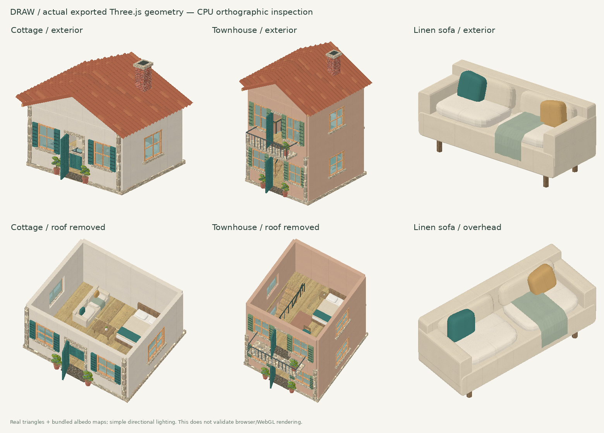

# DRAW — World Studio

Live: https://arisconstantinou.github.io/draw/

A hands-on 3D world builder for desktop and touch screens. Draw a street, build a room, paint a surface, sculpt a landscape, then walk through the place you made.



The image above is an inspection render of the actual model triangles and bundled albedo maps, showing exterior and roof-hidden views. It is not a browser screenshot or a substitute for WebGL visual verification.

## Run locally

The application is buildless. All JavaScript dependencies and surface textures are included in this repository.

```sh
python3 -m http.server 8000 --directory .
```

Open `http://localhost:8000` in a WebGL 2 capable browser. Do not open `index.html` directly through a `file:` URL; JavaScript modules need an HTTP server.

To check all application JavaScript:

```sh
npm run check
```

Run the 13 geometry, state and navigation integration checks with Node.js 20 or newer:

```sh
npm test
```

The run writes its results and tested source hashes to `verification/headless.json`. These tests exercise the real engine with DOM/GPU infrastructure adapters; they do not substitute for testing the rendered app on a physical device.

No package installation is needed for either command. Google Fonts is the only optional external runtime request; system fonts are used when it is unavailable.

## What is implemented

- A real Three.js 3D editor on a 76 × 76 metre landscape, with orbit, plan view, zoom, shadows, a grid and removable building roofs.
- 31 original, completed assets: five furnished building types; modular walls, floors, roof, stairs, doorway and window; roads, paving, lighting and street furniture; vegetation; household furniture; car and resident models.
- Houses with actual door and window openings, furnishings and roof geometry. Townhouse and apartment upper floors have floor openings, stairs, landings, railings and upstairs furnishings.
- Individually modelled curved clay roof tiles, window frames and shutters, balcony rails, furniture cushions and legs, and detailed street objects.
- A placement preview, half-metre grid snapping, elevation and rotation, plus selected-object position, scale, move, duplicate and delete controls.
- Custom wall and floor drawing, and streets following mouse or finger strokes.
- 16 PBR surface materials. Five CC0 Poly Haven scans provide locally bundled 1K albedo, OpenGL normal, roughness and height maps; remaining specialty materials are original seamless procedural textures.
- Actual terrain material blending, including normal/roughness maps and small geometric displacement. Drawn structural surfaces use subdivided geometry and height-map displacement.
- Terrain raise, lower, smooth and flatten brushes. These edit actual vertices and resettle placed objects.
- Per-surface model paint that survives save/load and undo/redo.
- First-person exploration, house entry, keyboard movement, touch walking controls, collision checks and stair support.
- Daylight, golden-hour and night lighting. Cars and residents follow actual road paths; the living-world toggle pauses animation.
- 25 undo states, project import/export, image capture and automatic persistence using IndexedDB on the current device.
- Mobile bottom navigation, responsive library sheets, safe-area support and a fixed canvas without page scrolling or browser tap highlights. Library content can scroll inside its own sheet.

## Controls

| Action | Desktop | Touch |
|---|---|---|
| Orbit | Drag with Select; hold Space/Alt while creating | Drag with Select; use two fingers while creating |
| Zoom | Wheel or + / − | Pinch or + / − |
| Place an asset | Choose an asset, click ground | Choose an asset, tap ground |
| Draw walls, floors and roads | Build → choose a construction tool → drag | Tap Build again for construction tools, then draw |
| Paint | Choose a material, brush ground or tap a model surface | Same with a finger |
| Sculpt | Choose Raise, Lower, Smooth or Flatten and drag | Same with a finger |
| Edit an object | Select it, use its properties or Move | Tap it, use its properties or Move |
| Enter a house | Select house → Step inside | Same |
| Walk | WASD / arrow keys, drag to look | Direction pad, drag to look |
| Rotate | R, or rotation controls | Rotation controls |
| Undo / redo | Ctrl/⌘ Z and Ctrl/⌘ Shift Z, or header buttons | Header buttons |
| Save | Ctrl/⌘ S or Save world | Save button |
| Return to overview | Escape | Exit, then Select |

Use **Elevation** to place structures above the ground. For a custom doorway, leave a gap between drawn wall segments and place the doorway asset. Door/window assets do not automatically cut boolean openings into existing walls.

## Saving and portability

The active world saves in the browser's IndexedDB. This is device- and browser-local storage, not account cloud synchronization. Export `.draw.json` from the project menu to keep a portable backup or move a world to another device. Imports are validated before replacing the active scene. Creating a new world remains undoable, but export separate projects if you want to retain more than one.

The app includes a web app manifest and works in a standalone Home Screen window where supported. It does not include a service worker or promise offline installation.

## Source structure

| File | Purpose |
|---|---|
| `index.html` | Accessible editor shell |
| `style.css` | Desktop layout and mobile bottom navigation/sheets |
| `app.js` | Editor UI, real-model library thumbnails, project storage/import/export |
| `engine.js` | Rendering, terrain, construction, picking, exploration, persistence and history |
| `assets.js` | Original detailed, editable geometry and semantic surface tags |
| `materials.js` | PBR materials, local scan loading and original seamless texture generation |
| `textures/` | Bundled scanned maps and source/license metadata |
| `vendor/` | Pinned Three.js r180 and OrbitControls |
| `tests/` | Reproducible geometry/state/navigation integration checks |
| `verification/headless.json` | Latest test evidence and source hashes |

## Verification and practical limits

The JavaScript syntax checks pass. Runtime geometry checks construct all 31 assets and verify finite vertices, grounding and building roof tags. Headless integration checks use actual Three.js geometry, CPU raycasts and the real engine methods to verify placement, house entry/exit, stair traversal, terrain editing, material persistence, undo/redo, safe import handling and animated road routing. The test adapters replace DOM/GPU infrastructure only; they do **not** verify shader compilation, visual output or frame rate.

The available cloud browser reported `GL_VENDOR = Disabled` and could not create a WebGL context. The responsive layout was measured at 390 × 844: no page overflow, a 390 px bottom navigation and all five main controls visible. GPU/browser interaction and physical iPhone performance remain to be verified on a WebGL 2 device.

The starting scene contains 56 editable objects and eight animated actors. The geometry inventory is approximately 404,000 triangles and 536 visible mesh submissions before shadow passes; this is not a frame-rate measurement. Materials and static asset components are reused/merged, but large worlds and high-detail buildings still depend on device capability. Import is capped at 1,500 editable objects.

Exploration and animated road traffic provide an interactive building experience, not a city-economy simulator or a general-purpose physics engine. House structures remain independently editable scene pieces; there is no multiplayer backend or automatic generation of architecture from natural language.

## Third-party material

Three.js r180 and OrbitControls are included under the MIT license; see `vendor/THREE-LICENSE.txt`. The scanned materials are CC0 from Poly Haven; see `textures/ATTRIBUTION.md` and `textures/sources.json`. Application assets and specialty textures are original code-generated models/materials.
