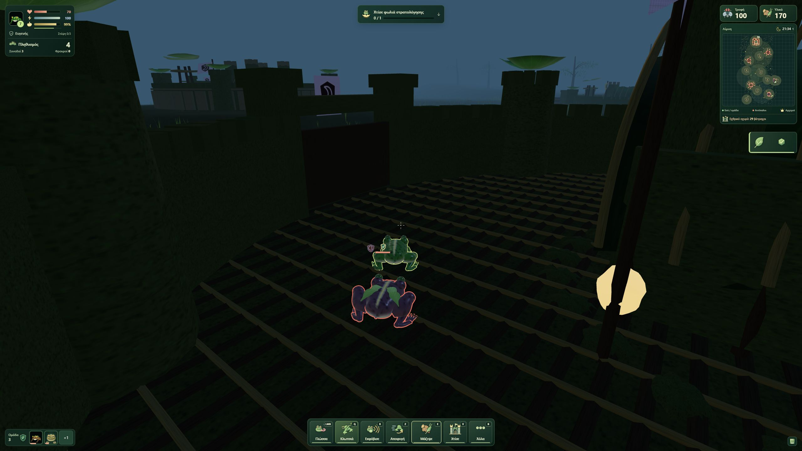

# Ζωντανή επαλήθευση FROG 1.4.0 — 25 Οκτωβρίου 2026

- Δημοσιευμένο παιχνίδι: https://arisconstantinou.github.io/frog/
- Commit εφαρμογής: `c6b9f9c40b75fb8f58c04faaec93b54f07748c9b`.
- GitHub Pages: [επιτυχής δημοσίευση](https://github.com/ArisConstantinou/ArisConstantinou.github.io/actions/runs/40182247052).
- Το πραγματικό DOM φόρτωσε το `./assets/index-DPzFngxn.js`.
- Πραγματικό στιγμιότυπο WebGL στα **2560 × 1440**, χωρίς αλλαγή του viewport ή συνθετικά δεδομένα: [live-v140.jpg](live-v140.jpg).

## Παρατηρήσεις

Η υπάρχουσα εκστρατεία φορτώθηκε με **Συνέχεια**. Εμφανίζει **Ευγενής**, **Στέψη 0/3**, **Πληθυσμός 4**, **Συνοδοί 3** και **Φρουροί 0**. Οι τρεις ήδη στρατολογημένοι σύμμαχοι διατηρήθηκαν. Δεν ξεκίνησε νέο παιχνίδι και δεν διαγράφηκε η αποθήκευση.

Η κύρια μπάρα εμφανίζει επτά κουμπιά: **Γλώσσα / LMB**, **Κλωτσιά / Q**, **Εκφόβισε / R**, **Αποφυγή / Z**, **Μάζεψε / E**, **Χτίσε / V** και **Άλλα / B**. Ο Εκφοβισμός είναι ορατός χωρίς άνοιγμα του B.

Ο χάρτης παραμένει ανοικτός πάνω δεξιά, με ενδείξεις πληθυσμού, πόρων και πραγματικού αντίπαλου οχυρού 29 βατράχων. Η θέση της αποθήκευσης είναι μέσα σε αντίπαλο κάστρο. Στη σύντομη δοκιμή οι αντίπαλοι επιτέθηκαν και η ζωή του ζωντανού παίκτη μειώθηκε από 70 σε 50. Το παιχνίδι αφέθηκε σε **Παύση** με ζωντανό παίκτη.

Ο έλεγχος καταγεγραμμένων σφαλμάτων της καρτέλας επέστρεψε κενή λίστα. Δεν πραγματοποιήθηκε νέο συγκρίσιμο benchmark FPS. Το στέμμα δεν είναι ορατό σε αυτή την εκστρατεία, επειδή η πρόοδος στέψης είναι 0/3· η εφαρμογή του στο μοντέλο και η συνθήκη στέψης καλύπτονται από τη σουίτα των 337 επιτυχών ελέγχων.

