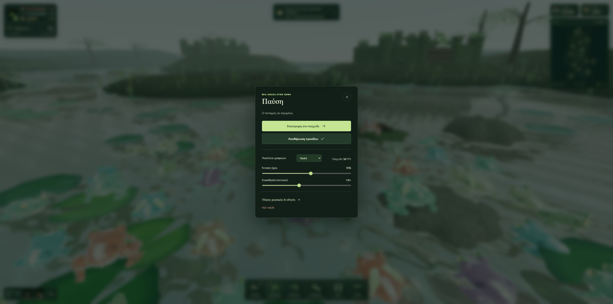

# FROG 1.3.2 — live performance verification

Date: 2026-10-25 (UTC)
Runtime commit: 8d147d16733472c00ad7db517f1082d43a1927ea
Live site: https://arisconstantinou.github.io/frog/
Pages deployment: https://github.com/ArisConstantinou/ArisConstantinou.github.io/actions/runs/40177109158
Runtime asset observed in the loaded page: assets/index-Bu-IS23M.js

## Observed in the live browser

- Existing campaign continued; no new-game reset.
- High graphics quality; 2560 × 1271 browser viewport.
- The opt-in console profiler recorded 46–47 FPS over five consecutive five-second samples with 70–71 living actors.
- The Pause screen subsequently showed a last-gameplay reading of 50 FPS. This is a smoothed reading, not a separate five-second average.
- The top HUD showed population 71 (52 companions, 18 guards, plus the player).
- The permanent minimap, campaign progress and population breakdown remained visible.
- No browser console errors were returned in the final error-log check.
- The game was left paused after verification.

Observed per-frame averages across the five profiler samples:
- Simulation: 1.57–1.83 ms
- World: 0.14–0.15 ms
- Actor models: 0.29–0.31 ms
- Camera: 0.03–0.04 ms
- HUD: 0.41–0.43 ms
- Renderer CPU submission: 6.31–6.60 ms

These are measurements of this stationary saved-game scene on the available browser, not a hardware-independent FPS guarantee or an old-versus-new FPS comparison. Renderer CPU time does not include complete GPU execution time.

## Automated validation

292 tests passed; zero failures. Production Vite build passed. All population and gameplay simulation remain active; geometry and distant animation detail adapt to rendering workload.

## Evidence

